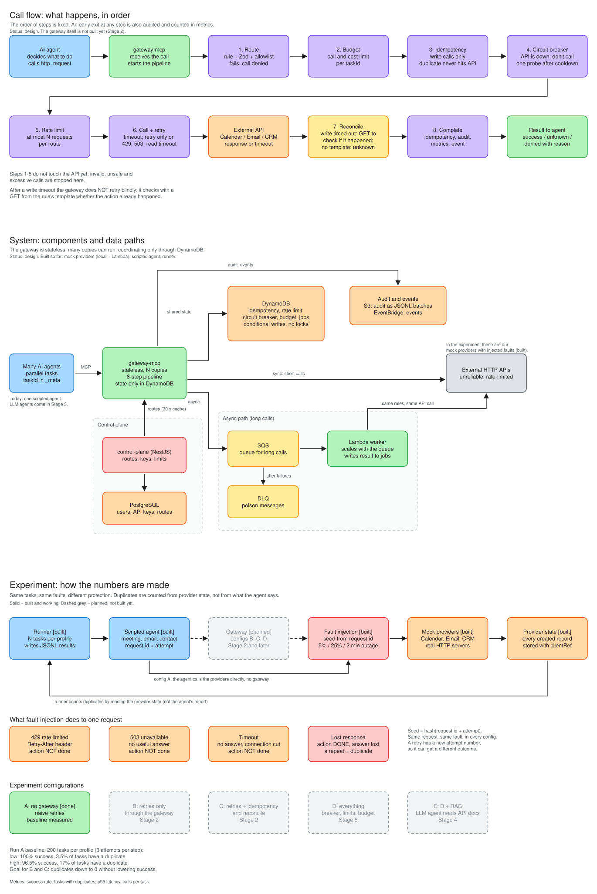

# Agent Reliability Gateway

> **Status: work in progress.** A personal research project with a reference implementation, not a product.

An MCP gateway that sits between an AI agent and unreliable external HTTP APIs. The model decides what to do; the gateway makes sure it is done safely, however the model behaves: argument validation, idempotency, retries with backoff, reconcile after write timeouts, rate limits, circuit breaker, per-task budgets and audit.

The project is also an experiment: the same agent tasks run with and without the gateway under injected faults, and the numbers (duplicate actions, success rate, p95, calls per task) are the main output.

## Architecture



## Development

Requires Node 22 and pnpm 10 (`corepack enable`).

```
pnpm install
pnpm lint
pnpm typecheck
pnpm test
```

## License

MIT
